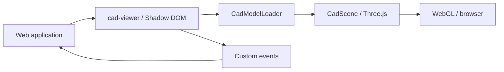

<h1 align="center">🧩 CAD Viewer</h1>

<p align="center"><em>3D CAD model viewer distributed as a Web Component.</em></p>

<p align="center">🇧🇷 <a href="README.md">Português</a> | 🇺🇸 English</p>

<p align="center"> </p>

<p align="center"><a href="#sobre">About</a> • <a href="#tecnologias">Technologies</a> • <a href="#como-rodar">Run locally</a> • <a href="#licenca">License</a> • <a href="#autor">Author</a></p>

---

<a id="sobre"></a>
## 📖 About

TypeScript plugin using Three.js to display GLB, glTF, STL, OBJ and PLY models in the browser. Supports rotation, zoom, camera movement and loading files locally or from URLs.

## ✨ Features

- Local and remote model loading
- Camera orbit, zoom and pan
- Grid and axis display
- Load and error events

<a id="tecnologias"></a>
## 🛠️ Technologies

   

## 📦 Prerequisites

Node.js and npm compatible with Vite 8.

<a id="como-rodar"></a>
## 🚀 Run locally

```bash
git clone https://github.com/Felipe-Amorim-Dev/CAD-Viewer.git
cd CAD-Viewer
npm ci
npm run build
npm run dev
```

## 📦 Package usage

```bash
npm install @felipe-amorim-dev/cad-viewer
```

```html
<cad-viewer src="/models/peca.glb" allow-file-selection="true"></cad-viewer>
```

## 🏗️ Architecture and technical workflow

The viewer combines a custom Web Component, a Three.js rendering layer and format-specific model loaders.

| Component | Responsibility |
| --- | --- |
| `src/components/CadViewerElement.ts` | Public `<cad-viewer>` element, attributes, methods and custom events |
| `src/components/template.ts` | Shadow DOM markup |
| `src/core/CadScene.ts` | 3D scene, camera, grid, controls and transforms |
| `src/core/ModelFitter.ts` | Model framing and camera fitting |
| `src/core/ModelDisposer.ts` | Graphics resource cleanup |
| `src/loaders/CadModelLoader.ts` | GLB, glTF, STL, OBJ and PLY loading |
| `src/types/cad-viewer-event.ts` | Loading, progress and error event contracts |



`load()` accepts URLs, while `loadFile()` reads local files. `CadModelLoader` creates scene objects and `CadScene` handles rendering and interactions. The Web Component watches `src`, `background`, `show-grid`, `show-axes`, `auto-rotate`, and `allow-file-selection` attributes.

## 📂 Supported 3D formats

| Format | Extension | Sources |
| --- | --- | --- |
| Binary glTF | `.glb` | File / URL |
| glTF | `.gltf` | File / URL |
| STL | `.stl` | File / URL |
| Wavefront OBJ | `.obj` | File / URL |
| PLY | `.ply` | File / URL |

GLB is a convenient distribution format when geometry, materials and textures need to travel in a single file.

## 🎛️ Component attributes

| Attribute | Default | Behavior |
| --- | --- | --- |
| `src` | empty | Model URL |
| `background` | `#eef1f5` | Background color |
| `show-grid` | `true` | Grid |
| `show-axes` | `false` | Axes |
| `auto-rotate` | `false` | Automatic camera rotation |
| `allow-file-selection` | `true` | Local file picker |

## 🧰 Public API

| Method | Purpose |
| --- | --- |
| `load(url)` | Load a 3D model by URL |
| `loadFile(file)` | Load a local File |
| `fitToModel()` | Fit camera to model |
| `resetView()` | Reset camera |
| `resetModelTransform()` | Reset model position and rotation |
| `removeModel()` | Remove current model |

## 📡 Custom events

- `cad-load-start` — model loading started
- `cad-progress` — loading progress
- `cad-loaded` — loading completed, including source and format
- `cad-error` — model loading error
- `cad-transform-change` — position, rotation or scale changed
- `cad-model-removed` — current model removed

## 🅰️ Angular integration

```typescript
import '@felipe-amorim-dev/cad-viewer';
import { Component, CUSTOM_ELEMENTS_SCHEMA } from '@angular/core';

@Component({
  selector: 'app-root',
  standalone: true,
  schemas: [CUSTOM_ELEMENTS_SCHEMA],
  template: '<cad-viewer src="/models/part.glb" show-grid="true"></cad-viewer>'
})
export class AppComponent {}
```

## ⚛️ React integration

```tsx
import '@felipe-amorim-dev/cad-viewer';

export function Viewer() {
  return <cad-viewer src="/models/part.glb" allow-file-selection="true" />;
}
```

## 🧑‍💻 TypeScript usage

```typescript
import { CadViewerElement } from '@felipe-amorim-dev/cad-viewer';
import '@felipe-amorim-dev/cad-viewer';

const viewer = document.querySelector<CadViewerElement>('#viewer');
await viewer?.load('/models/assembly.glb');
viewer?.fitToModel();
```

## 📦 Package development

```bash
npm ci
npm run typecheck
npm run build
npm run pack:check
```

The package is published as `@felipe-amorim-dev/cad-viewer`. The version in `package.json` is `0.1.1`; consumers install it using `npm install @felipe-amorim-dev/cad-viewer`.

## 🔒 File handling

Models chosen through the file picker are processed in the browser by the component and Three.js; this library does not require a backend for local viewing. External glTF files may depend on additional hosted textures and assets.

## 🤝 Contributions

Fork the repository, create a feature branch, implement the change and open a Pull Request. The CI workflow checks compilation and type-checking.

<a id="licenca"></a>
## 📄 License

Distributed under the [MIT license](LICENSE).

<a id="autor"></a>
## 👤 Author

**Felipe Figueiredo Amorim** — Full Stack Developer.

[](https://www.linkedin.com/in/felipe-amorim-dev/) [](mailto:felipe.f.amorim@outlook.com)

<p align="center"><strong>Obrigado por visitar! / Thanks for visiting!</strong></p>
